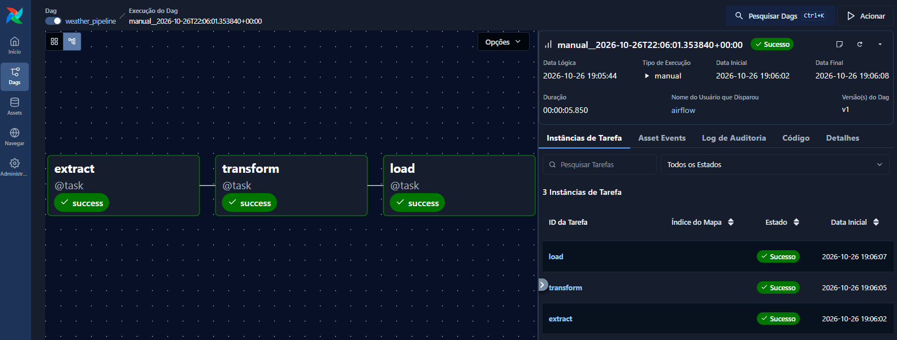

# Weather ETL Pipeline 🌤️

Pipeline de Engenharia de Dados desenvolvido em Python para coletar informações meteorológicas da API OpenWeatherMap, transformar os dados com Pandas e armazená-los em PostgreSQL. O fluxo é orquestrado pelo **Apache Airflow 3** e executado em contêineres Docker.

## 🎯 Objetivo

Aplicar, em um projeto prático, conceitos de **ETL (Extract, Transform, Load)**, orquestração de tarefas, integração com APIs, persistência em banco de dados relacional e organização de código em módulos.

## 🔄 Arquitetura do pipeline

```text
OpenWeatherMap API
       |
       v
  [Extract]
       |
       v
 data/weather_data.json
       |
       v
 [Transform] -- Pandas
       |
       v
 data/temp_data.parquet
       |
       v
    [Load]
       |
       v
   PostgreSQL
```

A DAG `weather_pipeline` executa as tarefas nesta ordem:

1. **Extract:** consulta a API OpenWeatherMap e salva a resposta em JSON.
2. **Transform:** lê e transforma os dados meteorológicos e gera um arquivo Parquet.
3. **Load:** lê o Parquet, estabelece conexão com PostgreSQL e adiciona os registros à tabela de destino.

As tarefas são encadeadas no Airflow por meio de `extract() >> transform() >> load()`.

## 📊 Execução do Pipeline

A imagem abaixo apresenta a execução bem-sucedida do pipeline ETL
no Apache Airflow, contemplando as etapas de extração,
transformação e carregamento dos dados.



## 🛠️ Tecnologias

- **Python** — desenvolvimento das etapas do pipeline.
- **Requests** — consumo da API meteorológica.
- **Pandas** — tratamento e transformação dos dados.
- **Apache Airflow 3** — orquestração e monitoramento das tarefas.
- **PostgreSQL** — armazenamento dos dados processados.
- **SQLAlchemy + psycopg2** — conexão e escrita no banco de dados.
- **Parquet** — arquivo intermediário entre as etapas de transformação e carga.
- **Docker Compose** — execução dos serviços em contêineres.
- **python-dotenv** — leitura de variáveis de ambiente.

## 📂 Estrutura do projeto

```text
weather-etl-pipeline/
├── config/
│   ├── connection.py       # Conexão com PostgreSQL
│   └── logger.py           # Configuração de logs
├── dags/
│   └── weather_dag.py      # DAG do Apache Airflow
├── data/                   # Arquivos JSON e Parquet gerados
├── logs/                   # Logs de execução
├── src/
│   ├── extract_data.py     # Extração dos dados
│   ├── transform_data.py   # Transformação dos dados
│   └── load_data.py        # Carga no PostgreSQL
├── .env.example            # Exemplo das variáveis de ambiente
├── docker-compose.yml     # Serviços Docker
└── README.md
```

> A estrutura acima destaca os principais arquivos do pipeline. Arquivos gerados e credenciais locais não devem ser versionados.

## ⚙️ Configuração

### 1. Clonar o repositório

```bash
git clone <URL_DO_REPOSITORIO>
cd weather-etl-pipeline
```

### 2. Configurar as variáveis de ambiente

Crie o arquivo `.env` na raiz do projeto a partir do `.env.example` e preencha os valores necessários, incluindo:

- Credenciais e parâmetros da API OpenWeatherMap (`API_URL`, `API_KEY`, `API_CITY`).
- Dados de conexão com PostgreSQL (`POSTGRES_HOST`, `POSTGRES_PORT`, `POSTGRES_DB`, `POSTGRES_USER`, `POSTGRES_PASSWORD`).
- Variáveis utilizadas pelos serviços do Airflow, conforme o `docker-compose.yml`.

**Importante:** dentro da rede do Docker Compose, o host do banco de dados da aplicação é o nome do serviço, `postgres`, e não `localhost`.

Nunca publique seu arquivo `.env` com chaves ou senhas reais.

### 3. Iniciar os serviços

```bash
docker compose config --quiet
docker compose up airflow-init
docker compose up -d
```

> A etapa de inicialização do Airflow deve ser executada conforme a configuração presente no `docker-compose.yml`.

### 4. Executar o pipeline

Acesse a interface do Airflow em `http://localhost:8080`, entre com as credenciais configuradas e execute manualmente a DAG **`weater_pipeline`**.

A DAG utiliza `schedule=None`, portanto não possui agendamento automático nesta versão.

### 5. Verificar a execução

No Airflow, acompanhe o status das tarefas **extract**, **transform** e **load**. Após uma execução bem-sucedida:

- O JSON extraído estará em `data/weather_data.json`.
- O arquivo transformado estará em `data/temp_data.parquet`.
- Os registros serão adicionados à tabela `weather_sp` do PostgreSQL.

## 🧩 Organização do código

O projeto separa responsabilidades em módulos:

- `config/connection.py`: cria e testa a conexão com PostgreSQL.
- `config/logger.py`: centraliza a configuração de logging.
- `src/extract_data.py`: realiza a requisição à API e salva o JSON.
- `src/transform_data.py`: aplica as transformações com Pandas.
- `src/load_data.py`: insere os dados transformados no PostgreSQL.
- `dags/weather_dag.py`: define as tarefas e suas dependências no Airflow.

## 📝 Observações

- A carga utiliza `if_exists="append"`: novas execuções adicionam registros, sem deduplicação automática nesta versão.
- O arquivo Parquet funciona como etapa intermediária entre as tarefas de transformação e carga.
- O projeto registra eventos e erros por meio de logging e permite que falhas sejam identificadas pelo Airflow.
- A configuração atual foi desenvolvida para fins de estudo e portfólio.

## 📚 Créditos e Referências

Este projeto foi desenvolvido com base no conteúdo educacional disponibilizado pelo canal **vbluuiza**, no YouTube, utilizado como referência para o aprendizado e a implementação prática de conceitos de Engenharia de Dados.

**Material de referência:** [Acessar tutorial no YouTube](https://www.youtube.com/watch?v=I8qPqbXQBDU)
